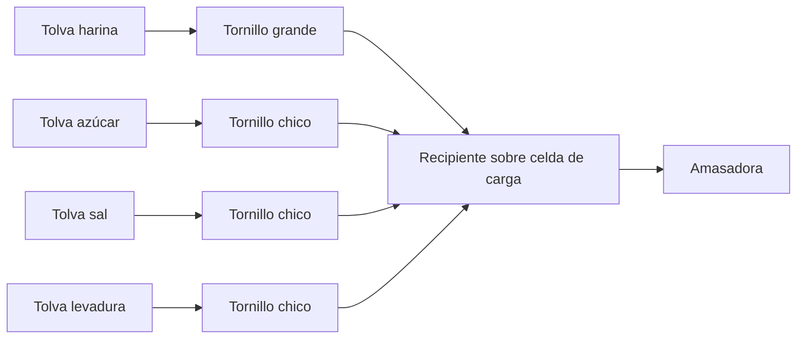
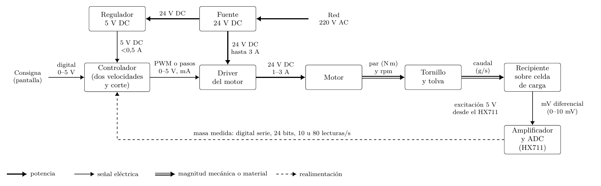

# Dosificadora gravimétrica de ingredientes secos — resumen para el tutor

**Caso:** Panadería San Miguel, Santa Cruz de la Sierra.
**Etapa estudiada:** dosificación de harina, azúcar, sal y levadura en polvo, antes del amasado.

---

## 1. Producción de la panadería

| Producto | Harina por ciclo | Unidades por ciclo | Ciclos por jornada ordinaria | Ciclos el sábado |
|---|---:|---:|:---:|:---:|
| Pan casero | 6,5 kg | 200 | 2 | 1 |
| Marraqueta | 8,0 kg | 150 | 2 | — |
| Pan francés | 7,5 kg | 132 | 1 | — |
| Masa común (empanadas y rollos) | 5,0 kg | 100 + 8 rollos | — | 1 |
| **Total por jornada** | | | **36,5 kg** | **11,5 kg** |

> Un **ciclo** es una preparación completa en la amasadora. En una jornada ordinaria
> hay 5 ciclos y el sábado 2.

---

## 2. Receta por ciclo (cantidades objetivo)

| Ingrediente | Pan casero | Marraqueta | Pan francés | Masa común |
|---|---:|---:|---:|---:|
| **Harina** | 6 500 g | 8 000 g | 7 500 g | 5 000 g |
| Azúcar | 400 g · 6,2 % | 80 g · 1,0 % | 80 g · 1,1 % | 150 g · 3,0 % |
| Sal | 100 g · 1,5 % | 150 g · 1,9 % | 150 g · 2,0 % | 100 g · 2,0 % |
| Levadura en polvo | 30 g · 0,46 % | 30 g · 0,38 % | 30 g · 0,40 % | 20 g · 0,40 % |

**Cómo leer la receta.**
- Los porcentajes son de **panadero**: cada ingrediente se expresa respecto de la
  harina del ciclo (harina = 100 %).
- La harina está en **kilogramos** y los otros tres en **gramos**. El equipo debe
  cubrir **de 20 g a 8 kg**, una relación de 400 a 1 entre la dosis más chica y la
  más grande.
- El pan casero es el más dulce: lleva 5 veces más azúcar que la marraqueta.
- La levadura es la dosis más chica y la más delicada: 2 g de error ya son entre
  el 7 y el 10 % de la dosis.
- La manteca y el agua también van en la receta, pero quedan **fuera del alcance**
  porque no son secos.

---

## 3. Cómo se dosifica hoy

| Ingrediente | Cómo lo carga el operario | ¿Usa la balanza? |
|---|---|:---:|
| Harina | 3 a 4 viajes al saco (3,20 m) con un recipiente y un ajuste final | Sí |
| Azúcar | 1 viaje al saco con un envase plástico, a ojo | No |
| Sal | Desde la mesa, con el mismo envase, a ojo | No |
| Levadura | Desde la mesa, con el mismo envase, a ojo | No |

---

## 4. Lo medido: objetivo frente a lo cargado (7 ciclos)

### Harina (pesada con balanza y ajuste final)

| Ciclo | Objetivo | Cargado | Diferencia |
|---|---:|---:|---:|
| Casero 1 | 6 500 g | 6 520 g | **+20 g** |
| Marraqueta 1 | 8 000 g | 8 018 g | **+18 g** |
| Francés | 7 500 g | 7 516 g | **+16 g** |
| Casero 2 | 6 500 g | 6 513 g | **+13 g** |
| Marraqueta 2 | 8 000 g | 8 011 g | **+11 g** |
| Casero (sábado) | 6 500 g | 6 538 g | **+38 g** |
| Masa común (sábado) | 5 000 g | 5 027 g | **+27 g** |
| **Total** | **48 000 g** | **48 143 g** | **+143 g** |

> Los 7 ciclos quedaron **por encima** del objetivo: el ajuste final siempre se
> pasa.

### Azúcar, sal y levadura (a ojo, sin lectura)

| Ciclo | Azúcar | Sal | Levadura |
|---|---:|---:|---:|
| Casero 1 | +14 g | +8 g | +3 g |
| Marraqueta 1 | +6 g | −7 g | −2 g |
| Francés | −6 g | +8 g | +2 g |
| Casero 2 | −7 g | −3 g | +1 g |
| Marraqueta 2 | +3 g | +4 g | −2 g |
| Casero (sábado) | +21 g | +9 g | +3 g |
| Masa común (sábado) | −6 g | −5 g | +2 g |
| **Balance neto** | **+25 g** | **+14 g** | **+7 g** |

> Aquí el error va **para los dos lados**. El total parece chico porque los excesos
> y los faltantes se compensan, pero ciclo a ciclo llega hasta el ±10 %.

### Comparación del error por ingrediente

| Ingrediente | Rango del error | Error medio en valor absoluto |
|---|---|---:|
| Harina (con balanza) | +11 a +38 g | **0,3 %** |
| Azúcar (a ojo) | −7 a +21 g | **4,8 %** |
| Sal (a ojo) | −7 a +9 g | **5,4 %** |
| Levadura (a ojo) | −2 a +3 g | **7,6 %** |

---

## 5. Tiempo del operario

| | Jornada ordinaria (5 ciclos) | Sábado (2 ciclos) | Total medido |
|---|---:|---:|---:|
| Harina | 304,5 s | 107,4 s | 411,9 s |
| Azúcar, sal y levadura | 110,7 s | 43,6 s | 154,3 s |
| **Total** | **415,2 s** | **151,0 s** | **566,2 s (9 min 26 s)** |

Cada ciclo toma de 74 a 89 s. El 63 % del tiempo de la harina se va en las cargas
y los viajes de vuelta.

---

## 6. El problema

**Proyección** a un mes de 22 jornadas ordinarias y 4 sábados (es un cálculo con
los datos medidos, no una medición mensual):

| Concepto | Por mes |
|---|---:|
| Tiempo del operario dosificando | **2 h 42 min** |
| Diferencia de harina | **+1,976 kg** |
| Diferencia neta de azúcar | +280 g |
| Diferencia neta de sal | +236 g |
| Diferencia neta de levadura | +64 g |

> **En una frase:** en San Miguel el operario destina unas 2 h 42 min al mes a
> dosificar a mano los ingredientes secos. La harina sale siempre por encima del
> objetivo y el azúcar, la sal y la levadura varían hasta ±10 % por ciclo,
> porque se cargan a ojo.

**Causas:** los traslados al saco, el ajuste final de la harina y la carga de los
ingredientes menores sin lectura de la balanza.

---

## 7. Idea de solución

Un prototipo **por lotes**: el operario elige la preparación y el equipo dosifica
los cuatro ingredientes hasta su cantidad objetivo.

| Parte | Decidido | Abierto |
|---|---|---|
| Alimentación | Tornillo para cada ingrediente | Diámetro, paso, velocidad |
| Medición | Celda de carga (galgas) y pesaje por lotes | Una celda para todo o una por ingrediente |
| Corte | Flujo grueso y fino, y corte un poco antes del objetivo | Cómo calcular ese adelanto |
| Control | — | Modelo, estrategia, controlador, motores |

---

## 8. Mi idea alternativa: una tolva con 4 compartimentos

**La idea:** una sola tolva dividida en 4 espacios, uno por ingrediente, con un
mecanismo central que gire según el ingrediente y una boquilla con compuerta.

**Qué dice la literatura:**

| Antecedente | Qué hicieron | Resultado |
|---|---|---|
| Bachtiar et al. (2026) | 6 compuertas con servomotor sobre una celda | Azúcar: **51 g de 120 g**. La compuerta no controla bien el polvo |
| Rumapea et al. (2026) | Compuerta con servomotor para harina | La harina forma una **bóveda** en la compuerta |
| Su (2017); Guan (2009) | Descarga de harina por gravedad | Se tapa si la abertura mide menos de 74 a 122 mm |
| Laime (2022) | Tolvas separadas que descargan a un **embudo común** | 0,8 g de error en 500 g |
| Humaira (2024) | 3 cámaras, cada una con su tornillo y su celda | 0,08 % de error en harina |

**Lectura:** el punto débil de la idea es la **compuerta**: con harina y azúcar
falla porque el polvo se traba o sale sin control. Lo que sí rescata la
literatura es la **salida común**: cada ingrediente con su propio tornillo, todos
descargando a un mismo embudo o recipiente (como Laime). Así se conserva la
idea de «un solo punto de salida» sin depender de una compuerta.

---

## 9. Diagrama de control (borrador)

### a) Lazo de un ingrediente, con lo que pasa por cada flecha

> Los voltajes y corrientes son **valores típicos de este tipo de equipo**, para
> discutir. Motor, driver, controlador y celda todavía no están seleccionados
> (`A-004`). La lógica entre lotes, que corrige el adelanto con el error del lote
> anterior, está en la Figura 2.18 de la tesis.

### b) Qué entra y qué sale de cada bloque

| Bloque | Energía que recibe | Señal que entra | Lo que sale |
|---|---|---|---|
| Fuente | Red 220 V AC | — | 24 V DC (para el driver y el regulador) |
| Regulador | 24 V DC | — | 5 V DC, menos de 0,5 A (para la parte lógica) |
| **Controlador** | 5 V DC | Consigna (digital) y masa medida (digital serie) | Señal de mando: PWM o pulsos de paso, 0–5 V y pocos mA |
| Driver | 24 V DC, hasta unos 3 A | Señal de mando del controlador | 24 V DC y 1–3 A hacia el motor, según el mando |
| Motor | 24 V DC y 1–3 A del driver | — | Par (N·m) y velocidad (rpm) en el eje |
| Tornillo y tolva | Giro del motor | Material de la tolva | Caudal de material (g/s) |
| Recipiente y celda | 5 V de excitación del HX711 | Peso del material (y golpes al caer) | Señal diferencial de unos mV (0–10 mV a plena carga) |
| HX711 | 5 V DC | mV de la celda | Lectura digital serie de 24 bits, 10 u 80 por segundo |

**Lo que muestra el diagrama:**
- El **controlador** no maneja potencia. Recibe 5 V para funcionar y trabaja con
  señales: compara la masa medida con la consigna y manda una señal débil, de
  mA, al driver.
- El **driver** es el que maneja la potencia. Toma los 24 V y los amperios de la
  fuente y se los entrega al motor según la orden del controlador.
- La **celda** convierte peso en una señal muy chica, de mV. Por eso necesita el
  amplificador y convertidor (HX711) antes de llegar al controlador.

**Mi duda:** en la teoría de control, el diagrama de bloques suele dibujar solo
señales, como en la Figura 2.18, y la energía va en un diagrama eléctrico aparte.
¿Conviene presentar los dos por separado o uno combinado como este?

---

## 10. Preguntas para el ingeniero

**Sobre la solución**
1. ¿Cómo ve la idea de una tolva con 4 compartimentos y una salida central, frente a
   un tornillo por ingrediente que descarga a un embudo común?
2. Para que un mismo equipo pese de 20 g a 8 kg, ¿le parece mejor una sola balanza o
   una para la harina y otra para los ingredientes chicos?

**Sobre el diagrama de control**
3. ¿Cuál es la forma correcta del diagrama? ¿Separo el diagrama de bloques del
   control, solo con señales, del diagrama eléctrico con fuente, driver y motor?
4. ¿Qué entra realmente al bloque del controlador y dónde se dibuja la energía?
5. El material que todavía está cayendo al cortar, ¿se trata como un retardo o
   como una perturbación?

**Sobre el control**
6. ¿Basta con encender y apagar el motor en dos velocidades (grueso y fino), o
   hace falta un lazo cerrado, por ejemplo un PI como en Farihin et al. (2021)?
7. Para el modelo del sistema, ¿conviene deducirlo con ecuaciones o medirlo
   (aplicar una velocidad al tornillo y registrar cómo sube el peso)?
8. ¿El control se debe plantear en tiempo continuo o directamente en discreto,
   dado que la celda entrega de 10 a 80 lecturas por segundo?
9. Para un prototipo, ¿alcanza un microcontrolador (Arduino o ESP32) o recomienda
   un PLC?

---

*Fuentes: levantamiento del 02/09/2026 y del 05/09/2026
(`research/notes/levantamiento_dosificacion_san_miguel.md`), decisiones del
proyecto (`context/DECISIONS.md`) y estado del arte del capítulo 2, con la lectura
apoyada en NotebookLM.*
